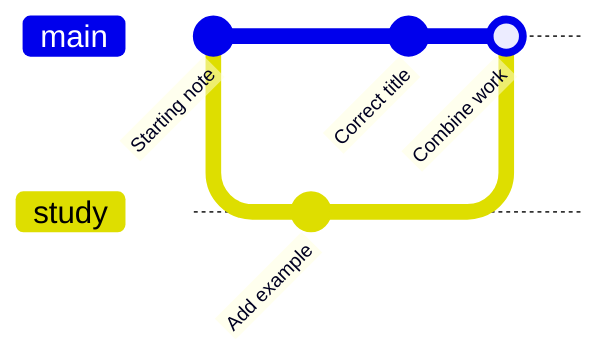
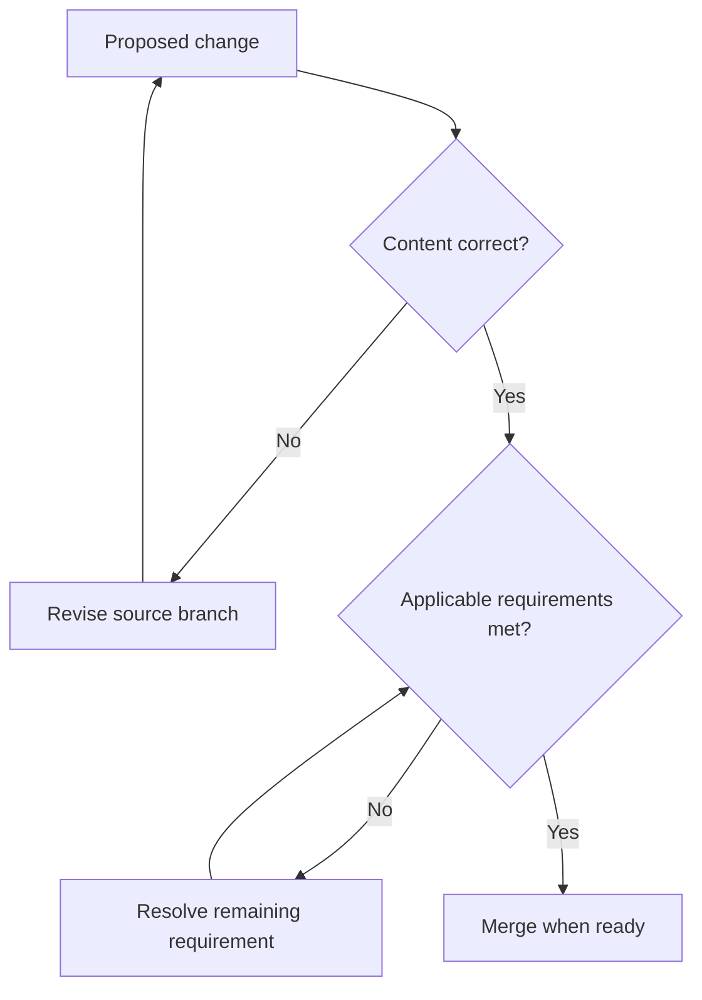

# See what changes in Git and GitHub

[Table of contents](../CONTENTS.md) · [Command dictionary](command-dictionary.md)

## A branch can diverge and merge

This example has a starting commit, separate changes on main and a study branch, and a merge. It is an illustration, not a screenshot of this repository's history.

Both lines share earlier history. A branch is not a second GitHub account or a fork. Whether a merge needs manual conflict resolution depends on the changes. A graph alone does not prove the combined file is correct.

Try the [local graph lab](../labs/12-read-a-local-history.md) to create this kind of history and inspect it.

## A PR may need more than a green check

A passing check is one piece of evidence. Read the diff and the merge status. Draft state, required reviews, and configured rules can still matter. The diagram is a review aid; it does not list every possible rule or bypass setting.

## Before and after a local commit

| Observation | Before committing | After committing, before pushing |
| --- | --- | --- |
| Working file | Contains your saved edit | Still contains the edit |
| Staged diff | Shows the selected change | Usually empty if all staged work was committed |
| Local history | Does not contain the new commit | Contains it |
| GitHub branch | Has not received the local change | Still has not received it |

The table assumes a simple edit with no additional changes during the sequence. If you edit again after staging, staged and unstaged changes can coexist.

Sources: [GitHub flow](https://docs.github.com/en/get-started/using-github/github-flow), [Git merge](https://git-scm.com/docs/git-merge), [Git add](https://git-scm.com/docs/git-add). Continue with [Git step by step](git-step-by-step.md).
