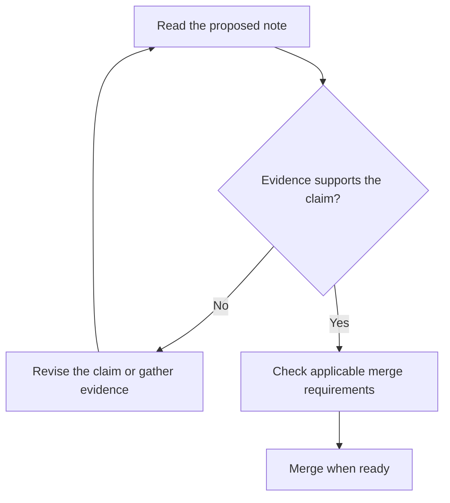

# Lab 14: Explain one relationship with a diagram

[Table of contents](../CONTENTS.md)

Goal: turn a short process into a diagram and verify that its explanation agrees with the drawing. Work on a branch in your own sandbox.

## Build the note

Create a Markdown note explaining how you decide whether to revise a proposed documentation change. Include this example, then adapt the labels to your own task:

The example says that unsupported wording needs revision or more evidence. Even supported wording still needs the applicable merge requirements checked. It does not claim that any particular rule is enabled.

## Inspect the result

1. View the Markdown preview on GitHub and confirm that a diagram appears.
2. Read every arrow aloud as a sentence. Check that its direction matches the process.
3. Add a paragraph explaining the same relationship so the meaning does not depend on seeing the image.
4. Make one deliberate wording improvement on your practice branch. Review the source diff and the rendered result.
5. Commit the note and use a PR into your sandbox if you want review practice.

Use a fenced block labeled mermaid. An editor that displays only the source may lack a renderer; that does not by itself prove the diagram is invalid. If GitHub reports a rendering error, simplify the syntax and check its documentation.

Completion: the drawing renders, the text agrees with it, and you can explain one revision. Do not record rendering as checked unless you actually viewed the result.

Source: [Creating diagrams on GitHub](https://docs.github.com/en/get-started/writing-on-github/working-with-advanced-formatting/creating-diagrams). Continue with the [simulation case study](../practice/simulation-case-study.md).
